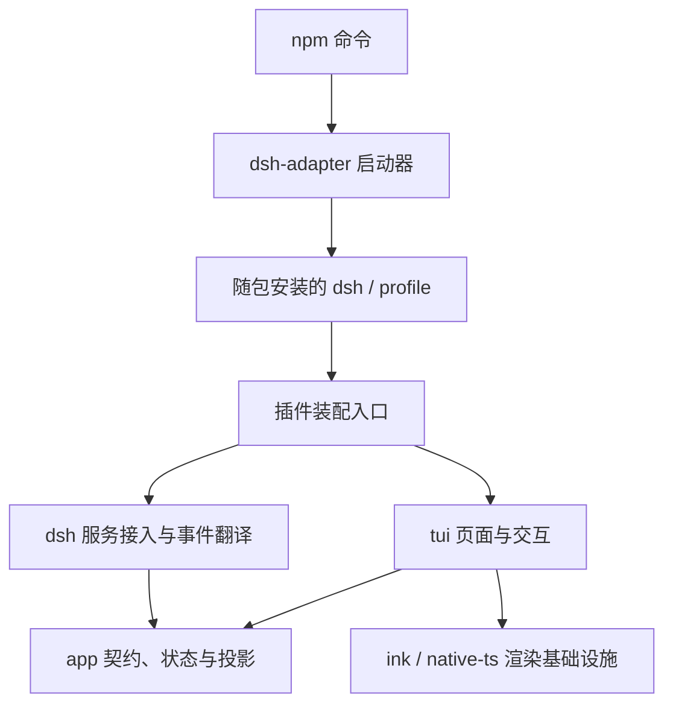

# 客户端架构

本项目是完整 dsh 终端客户端，以 Cordis 插件形式加载。一个 npm 包同时安装客户端和经过验证的内核；用户执行 `dsh-tui` 即可启动。本轮整理结构与启动流程，后续在这些边界上补充产品能力。

## 目录与职责

| 位置 | 职责 |
| --- | --- |
| `bin/` | npm 命令入口，调用编译后的启动器 |
| `src/dsh-adapter/` | dsh 接入、宿主服务、事件翻译、profile 启动与插件装配 |
| `src/app/` | 客户端契约、可写状态、消息投影、输入流程、问答存储、配置向导和偏好 |
| `src/tui/` | 页面、组件、主题、终端文本排版与界面退出清理 |
| `src/ink/`、`src/native-ts/` | 已有终端渲染器和布局实现 |
| `src/utils/` | 文本、文件、剪贴板和图像等基础工具 |

`app/contracts/client.ts` 汇总客户端读状态、输入、会话、模型和服务接口。展示数据按消息、子代理、后台任务、输入、模型和会话拆分。适配层使用这些类型，不向界面转导出官方类型。

## 运行链路

1. 启动器从自身依赖定位 dsh CLI，以当前 Node 运行它，不搜索全局 PATH。
2. 专用 profile 组合官方 `dsh-base` 与当前 TUI bundle。profile 中本包的链接始终指向当前 npm 安装，不复制安装另一份 TUI。
3. bundle 只做终端 surface 所需装配：关闭 HMR、声明宿主 preset 服务、装载认证及 TUI。用户 profile patch 位于 bundle 之后。
4. `dsh-adapter/plugin.ts` 负责装配。`agent-lifecycle.ts` 通过官方服务创建或恢复 agent；频道模块桥接宿主能力；`backend/session.ts` 翻译持久化事件和实时帧。
5. `app` 将规范化事件投影为客户端状态，`tui` 订阅状态并发起操作。状态初始化、重置、通知和输入取消/重新投递属于客户端。
6. 退出策略区分用户退出与插件卸载。卸载释放当前实例；用户退出先恢复终端，再清理宿主。

## 依赖规则

- `@deepseek-ai/*` 的静态、动态及类型导入仅允许出现在 `dsh-adapter`。
- `app` 不依赖 `tui`、渲染器或适配实现；`tui` 只消费客户端接口，不调用适配实现。
- 包的根入口是插件桥接入口；其余共享模块和渲染器不得反向导入适配层。
- dsh 相关代码变动留在适配目录；客户端接口只表达终端实际需要的状态与操作。
- `ChannelServices` 是装配时的内部接线对象，不能在启动后注册功能；它不是第三方 TUI 插件 API。

`verify-boundaries.mjs` 通过 TypeScript AST 检查上述导入规则；不能通过转导出官方类型绕过边界。

## 状态和生命周期

- agent、工具执行、权限策略和持久化由 dsh 负责。客户端不注册替代内核，也不自行维护另一份事实存储。
- transcript 中的事件顺序、序列锚点和 tool call ID 必须保留。实时增量是临时展示，最终与持久化结算对齐。
- 草稿、菜单、展开、通知等由客户端维护；消息投影与文件存储不混合。
- 会话绑定以对象身份和递增 generation 隔离异步操作。切换或卸载后的回调不得写入新会话。
- 资源清理通过统一 owner 注册；准备、采用和释放会话仍保留已有事务保护。
- 其他 dsh 插件的普通工具结果通过通用工具展示路径呈现。暂无面板、快捷键等第三方界面扩展 API。

## 已移除的历史结构

多后端安装与注册契约、跨后端身份、通用 capability 转发、`native.dsh` 逃逸通道、第二套会话打开/历史恢复与活动投影、启动时下载安装副本、自更新和救援 profile 均已删除。现有消息与输入正确性保护、会话数据格式和渲染器主体保留。

新增功能时：先确认 dsh 是否已提供所需服务；适配调用放在 `dsh-adapter`，客户端流程与数据契约放在 `app`，显示和按键交互放在 `tui`。不为未出现的其他内核或界面插件建立通用框架。
