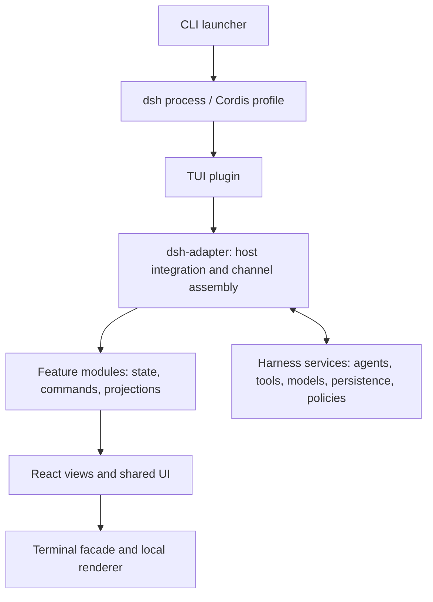
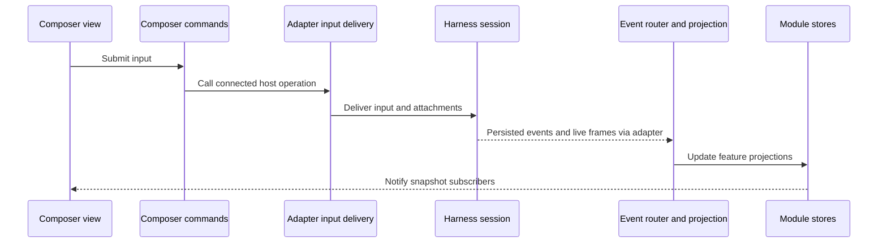

# Architecture

**English** | [简体中文](architecture.zh-CN.md) · [README](../README.md)

This guide explains how dsh TUI Lite runs, how its parts communicate, and where to make changes. It describes the current implementation; development plans under `docs/superpowers/` are historical context.

## 1. System overview

The client runs as a Cordis plugin inside the dsh process launched by its CLI. DeepSeek Harness owns agents, model execution, tools, durable sessions, and policies. The client translates those capabilities into terminal input, conversation views, menus, and approval panels.

Arrows show startup and integration relationships, rather than a complete import graph. User actions travel back through module commands; host events return through the adapter and module stores.

### Source map

| Location | Responsibility |
| --- | --- |
| `bin/` | Executable entry that loads the compiled launcher |
| [`src/dsh-adapter/`](../src/dsh-adapter/) | Launcher, Cordis plugin, Harness integration, event translation, and channel assembly |
| [`src/modules/`](../src/modules/) | Feature logic, state, public contracts, and feature views |
| [`src/shared/`](../src/shared/) | Internal protocols, platform utilities, state publication, and resource lifetimes |
| [`src/ui/`](../src/ui/) | Shared themed components, forms, Markdown, and presentation helpers |
| [`src/terminal/`](../src/terminal/) | Rendering and input facade, external editor, and shutdown |
| `src/ink/`, `src/native-ts/` | Local terminal renderer, input parsing, graphics, and layout implementation |
| [`scripts/`](../scripts/) | Architecture checks and behavior verification |
| `lib/` | Generated JavaScript and declarations; edit `src/` instead |

## 2. Startup and shutdown

1. [`bin/dsh-tui.js`](../bin/dsh-tui.js) calls the compiled version of [`launcher.ts`](../src/dsh-adapter/launcher.ts). The launcher resolves the bundled dsh installation rather than searching the global PATH.
2. The launcher prepares the dedicated `dsh-tui` profile, combines the official base bundle with this client, and links the profile to the current installation. It preserves user profile patches and backs up replaced profile data where needed.
3. [`plugin.ts`](../src/dsh-adapter/plugin.ts) checks the terminal and runtime, resolves the model and working directory, and creates or resumes an agent. An explicit CLI launch requires an interactive terminal; loading the plugin in a headless host does not mount the UI.
4. [`channel.ts`](../src/dsh-adapter/channel.ts) assembles the runtime in three stages: create the core, configure dsh services, then start. Construction failures release resources acquired by the channel.
5. The plugin renders `Chat` with restricted module bindings and separate approval/question stores. Host connections are installed before module commands are activated and event subscriptions begin.

On user exit, the exit funnel restores the terminal and performs host cleanup. Plugin unload also releases the channel, subscriptions, timers, and pending decisions. Resource cleanup belongs to the owner that acquired each resource.

## 3. Feature modules and their interfaces

| Module | Owns | Typical change |
| --- | --- | --- |
| `composer` | Pending input, cancellation state, draft editing controllers, history, completion, and image input | Change editing or submission behavior |
| `transcript` | Conversation rows, event projection, usage, streaming presentation, and history windows | Change how a persisted message or tool result appears |
| `sessions` | Current session identity and status, session browsing, and switching workflows | Change new/resume/rename behavior |
| `settings` | Model and effort selection, preferences, provider configuration, and authentication workflows | Add a provider configuration step |
| `activity` | Task and subagent projections, cards, and controls | Change background activity presentation |
| `workbench` | Command catalog, notifications, cross-module projection coordination, and the main chat view | Add a menu or coordinate a user action |
| `decisions` | Approval and question contracts, interaction rules, and panels | Change approval or question interaction |

Six modules expose state owners constructed by the channel. `decisions` uses separate approval and question stores wired by the plugin; it is not a seventh owner in the six-store runtime.

### Public and internal surfaces

Every feature has `index.ts` for runtime exports and `contracts.ts` for public types. Other modules and the adapter consume these entries instead of private implementation files. Feature `model/` code contains logic independent of React and terminal rendering; `ui/` contains views and interaction controllers.

The six state owners expose these surfaces:

| Surface | Consumer | Meaning |
| --- | --- | --- |
| `store.getSnapshot()` / `store.subscribe()` | UI | Read and subscribe to a module's committed snapshot |
| `commands` | UI and coordinating logic | Request an operation through the owning module |
| `ingress` | Runtime assembly and event routing | Apply specific host facts or projection updates |
| `connectHost()` / `startCommands()` / `dispose()` | Runtime assembly | Connect capabilities, activate commands, and end the module lifetime |

[`workbench-bindings.ts`](../src/dsh-adapter/workbench-bindings.ts) exposes only `store` and `commands` to the renderer. Writers and lifecycle controls remain internal. Commands are stable objects, require an active host connection, and become unusable after disposal. This also applies to controls retained by an old view.

UI state has several owners: module snapshots hold shared feature facts, while local React state holds transient editing or menu interaction. A module snapshot is not a copy of the entire Harness state.

## 4. Following a user action

### Sending a message

Start with [`composer/ui/controllers/submission.ts`](../src/modules/composer/ui/controllers/submission.ts), then follow [`input-delivery.ts`](../src/dsh-adapter/channel/input-delivery.ts). The input queue preserves delivery order and session ownership. Pending previews belong to the composer; they do not prove that Harness has accepted or executed an input.

### Running a command

[`shared/commands.ts`](../src/shared/commands.ts) declares local slash commands. [`workbench/model/chat-commands.ts`](../src/modules/workbench/model/chat-commands.ts) routes them to module operations and menus. The adapter merges commands supplied by the Harness registry into the runtime catalog; local names take precedence. `/help` and completion use the runtime catalog, so available commands can depend on installed services.

A new command therefore needs both a catalog entry and an implementation route. If it needs a new Harness capability, expose that through the adapter and the owning module's host contract.

## 5. Transcript, snapshots, and session changes

### From Harness events to terminal rows

The persisted transcript is the source of truth for conversation history. Live frames supply in-progress presentation; the client must preserve event order, sequence anchors, and tool call IDs so that replay and live updates agree.

- [`backend/translate.ts`](../src/dsh-adapter/backend/translate.ts) normalizes Harness records and live frames into the internal event protocol.
- [`channel/core/binding-feed.ts`](../src/dsh-adapter/channel/core/binding-feed.ts) connects session subscriptions to the event router and projection.
- [`workbench/model/session-batch.ts`](../src/modules/workbench/model/session-batch.ts) checks the current binding, handles status and pending-input bookkeeping, and preserves reset boundaries within a batch.
- [`transcript/model/projection.ts`](../src/modules/transcript/model/projection.ts) reduces normalized events into transcript rows; workbench projection coordinates the required facts across modules.

Task and subagent projections also update activity views and their transcript rows through explicit interfaces. Folded history is restored through the session's durable transcript; display truncation must not become data loss.

### Snapshot publication

[`shared/state/module-store.ts`](../src/shared/state/module-store.ts) supplies per-module stores and a shared publication coordinator. A batch installs all changed snapshots before notifying subscribers, so a view does not observe a partially applied cross-module update. Unchanged snapshots retain their identity.

Streaming updates commit snapshots while coalescing subscriber notifications on an approximately 16 ms timer. Events marked `wake: none` can commit facts without waking the UI. This is notification scheduling, not persistence or a separate event bus.

### Switching sessions safely

New-session, resume, and model-fork workflows have different host operations and race checks. Their orchestration lives in `sessions/model/`; the adapter acquires and binds real Harness resources.

A binding capture includes a generation. Event handlers and asynchronous work check that capture before updating the current view, preventing late results from the previous binding from entering the replacement session. Session adoption resets and replays projections before subscribers are notified. Failures before adoption keep the old session; failures during initialization after adoption revoke the new binding and report the error.

## 6. Dependency rules

The source boundary checker enforces the following rules, including type imports, re-exports, and literal dynamic imports:

- `@deepseek-ai/*` imports stay in `src/dsh-adapter/`. Feature code uses host contracts and internal protocol types.
- Cross-feature imports use `index.ts` or `contracts.ts`, and feature dependencies must be acyclic.
- Feature models do not import React, their UI, or terminal rendering code.
- Shared infrastructure does not import features or rendering layers. Shared UI does not import features or the adapter; the terminal facade does not import business UI.

The channel's two composition points have distinct jobs: [`core/compose.ts`](../src/dsh-adapter/channel/core/compose.ts) creates module owners, input/event plumbing, and lifecycle management; [`composition.ts`](../src/dsh-adapter/channel/composition.ts) connects Harness-specific services. Neither should become another aggregate copy of module state.

## 7. Making and checking a change

| Change | Start here | Relevant verification scripts |
| --- | --- | --- |
| Input editing or delivery | `composer` and adapter input delivery | `verify-composer-delivery.ts`, `verify-prompt-*.mjs` |
| Message rendering or replay | Translator, transcript projection, transcript UI | `verify-dsh-translate.ts`, `verify-projection-golden.ts`, `verify-transcript-restoration.ts` |
| Session switching | `sessions/model/` and adapter binding | `verify-session-transitions.ts`, `verify-binding-transaction.ts`, `verify-session-adoption.ts` |
| Providers or models | `settings/model/` and adapter settings/model services | `verify-provider-wizard.mjs`, `verify-model-configuration.ts`, `verify-settings-actions.ts` |
| Commands or help | Command catalog and workbench routing/UI | `verify-workbench-commands.ts`, `verify-command-suggestions.mjs`, `verify-help-panel.tsx` |
| Module boundaries or wiring | Module contracts and channel composition | `verify-boundaries.mjs`, `verify-feature-modules.mjs`, `verify-adapter-composition.ts` |

These scripts live in `scripts/`. Read [`scripts/verify.mjs`](../scripts/verify.mjs) for the supported suite and loader requirements of individual checks.

For code changes, run `pnpm build`, relevant focused checks, and `pnpm verify`. Terminal UI changes also require narrow-TTY verification. Packaging changes additionally use `pnpm verify:package`. Documentation-only changes require diff and link checks. See [CONTRIBUTING](../CONTRIBUTING.md) and [repository rules](../AGENTS.md) for contribution requirements.
