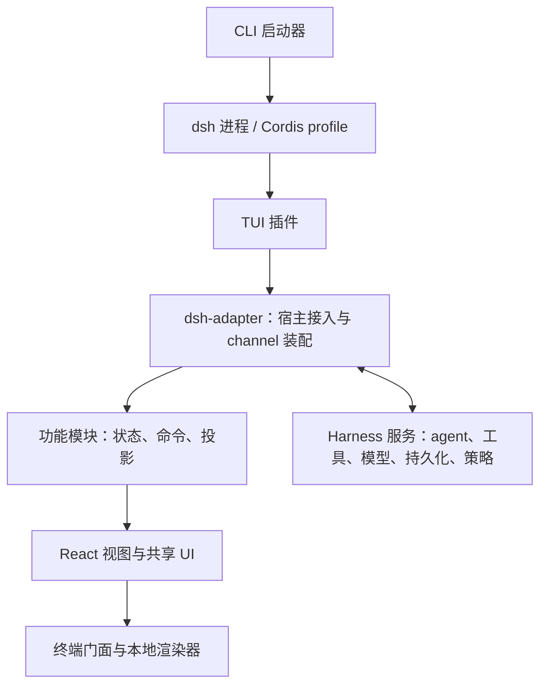
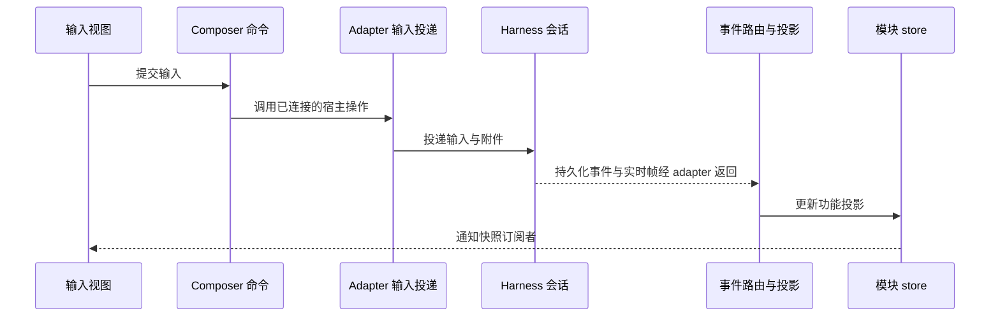

# 项目架构

[English](architecture.md) | **简体中文** · [README](../README.zh-CN.md)

本文介绍 dsh TUI Lite 如何运行、各部分如何协作，以及修改功能时应该从哪里入手。内容描述当前实现；`docs/superpowers/` 下的开发计划用于追溯历史背景。

## 1. 系统全貌

客户端以 Cordis 插件形式运行在 CLI 启动的 dsh 进程中。DeepSeek Harness 负责 agent、模型执行、工具、持久化会话与策略；客户端将这些能力呈现为终端输入、对话视图、菜单和审批面板。

箭头表示启动与接入关系，并非完整的代码依赖图。用户操作通过模块命令反向调用宿主，宿主事件则经 adapter 和模块 store 回到界面。

### 源码地图

| 位置 | 职责 |
| --- | --- |
| `bin/` | 可执行入口，加载编译后的启动器 |
| [`src/dsh-adapter/`](../src/dsh-adapter/) | 启动器、Cordis 插件、Harness 接入、事件翻译和 channel 装配 |
| [`src/modules/`](../src/modules/) | 功能逻辑、状态、公开契约与功能视图 |
| [`src/shared/`](../src/shared/) | 内部协议、平台工具、状态发布和资源生命周期 |
| [`src/ui/`](../src/ui/) | 共享主题组件、表单、Markdown 与展示工具 |
| [`src/terminal/`](../src/terminal/) | 渲染与输入门面、外部编辑器和终端恢复 |
| `src/ink/`、`src/native-ts/` | 本地终端渲染器、输入解析、图像协议和布局实现 |
| [`scripts/`](../scripts/) | 架构边界与功能验证 |
| `lib/` | 生成的 JavaScript 和类型声明；应修改 `src/` |

## 2. 启动与退出

1. npm 包 `dsh-tui-lite` 提供 `dsl` 和 `dsh-tui-lite` 两个命令，均由 [`bin/dsh-tui.js`](../bin/dsh-tui.js) 调用 [`launcher.ts`](../src/dsh-adapter/launcher.ts) 的编译产物。启动器解析随包安装的 dsh，不搜索全局 PATH，并使用独立的 `dsh-tui-lite` profile。
2. 启动器准备专用的 `dsh-tui-lite` profile，组合官方基础 bundle 与当前客户端，并将 profile 链接到当前安装。用户 profile patch 会保留，需要替换的 profile 数据按实现保留备份。
3. [`plugin.ts`](../src/dsh-adapter/plugin.ts) 检查终端和运行版本，确定模型及工作目录，创建或恢复 agent。通过 CLI 显式启动需要交互式终端；在无终端宿主中加载插件不会挂载 UI。
4. [`channel.ts`](../src/dsh-adapter/channel.ts) 分三步装配运行时：创建 core、配置 dsh 服务、启动。构造失败时释放 channel 已取得的资源。
5. 插件将受限的模块绑定与独立审批、问答 store 交给 `Chat` 渲染。宿主能力连接完成后，才激活模块命令并开始订阅事件。

用户退出时，统一退出流程负责恢复终端并清理宿主。插件卸载也会释放 channel、订阅、定时器与未完成的决策。每项资源由取得它的 owner 负责清理。

## 3. 功能模块与接口

| 模块 | 负责内容 | 常见修改 |
| --- | --- | --- |
| `composer` | 待发输入、取消状态、草稿编辑控制器、历史、补全与图片输入 | 修改编辑或提交行为 |
| `transcript` | 对话行、事件投影、用量、流式展示与历史窗口 | 修改持久化消息或工具结果的显示 |
| `sessions` | 当前会话身份与状态、会话浏览和切换流程 | 修改新建、恢复、重命名行为 |
| `settings` | 模型与推理强度选择、偏好、服务商配置与认证流程 | 增加服务商配置步骤 |
| `activity` | 任务与子代理投影、卡片及控制操作 | 修改后台活动展示 |
| `workbench` | 命令目录、通知、跨模块投影协调与聊天主界面 | 增加菜单或协调用户操作 |
| `decisions` | 审批与问答契约、交互规则和面板 | 修改审批或问答交互 |

channel 创建六个模块状态 owner。`decisions` 使用由插件接线的独立审批、问答 store，不属于这六个 store，也不是第七个同构状态 owner。

### 公开接口与内部接口

每个功能模块通过 `index.ts` 导出运行时能力，通过 `contracts.ts` 导出公开类型。其他模块和 adapter 使用这些入口，不访问私有实现文件。`model/` 放不依赖 React 和终端渲染的逻辑，`ui/` 放视图与交互控制器。

六个状态 owner 提供以下接口：

| 接口 | 使用者 | 含义 |
| --- | --- | --- |
| `store.getSnapshot()` / `store.subscribe()` | UI | 读取并订阅所属模块已提交的快照 |
| `commands` | UI 和协调逻辑 | 向拥有该操作的模块发出请求 |
| `ingress` | 运行时装配与事件路由 | 写入明确的宿主事实或投影更新 |
| `connectHost()` / `startCommands()` / `dispose()` | 运行时装配 | 连接能力、激活命令和结束模块生命周期 |

[`workbench-bindings.ts`](../src/dsh-adapter/workbench-bindings.ts) 只向渲染层暴露 `store` 与 `commands`，不暴露写入和生命周期控制接口。命令对象保持稳定，需要已激活的宿主连接；模块释放后命令失效，旧视图保留的控制对象也不能继续使用。

界面状态有不同归属：模块快照保存共享的功能事实，局部 React 状态保存临时编辑和菜单交互。模块快照不复制整个 Harness 状态。

## 4. 跟踪一次用户操作

### 发送消息

从 [`composer/ui/controllers/submission.ts`](../src/modules/composer/ui/controllers/submission.ts) 入手，再跟踪 [`input-delivery.ts`](../src/dsh-adapter/channel/input-delivery.ts)。输入队列保留投递顺序和原会话归属。待发预览由 composer 管理，不能据此认定 Harness 已接受或执行输入。

### 执行命令

[`shared/commands.ts`](../src/shared/commands.ts) 声明本地斜杠命令，[`workbench/model/chat-commands.ts`](../src/modules/workbench/model/chat-commands.ts) 将其路由到模块操作或菜单。adapter 将 Harness 命令注册表提供的命令合并到运行时目录，本地同名命令优先。`/help` 与补全读取运行时目录，因此可用命令可能随已安装服务变化。

新增命令需要同时接入命令目录和执行路由。如果需要新的 Harness 能力，应通过 adapter 和所属模块的宿主契约提供。

## 5. Transcript、快照与会话切换

### 从 Harness 事件到终端对话行

持久化 transcript 是对话历史的事实来源。实时帧补充进行中的展示；客户端必须保留事件顺序、序列锚点和 tool call ID，确保历史重放与实时更新一致。

- [`backend/translate.ts`](../src/dsh-adapter/backend/translate.ts) 将 Harness 记录和实时帧翻译为内部事件协议。
- [`channel/core/binding-feed.ts`](../src/dsh-adapter/channel/core/binding-feed.ts) 将会话订阅连接到事件路由和投影。
- [`workbench/model/session-batch.ts`](../src/modules/workbench/model/session-batch.ts) 检查当前绑定，处理状态和待发输入账目，并保留事件批次内部的 reset 边界。
- [`transcript/model/projection.ts`](../src/modules/transcript/model/projection.ts) 将规范化事件归约为对话行；workbench 投影负责协调涉及多个模块的必要事实。

任务和子代理投影还会通过明确接口更新 activity 视图及对应对话行。折叠的历史通过会话的持久化 transcript 恢复，展示截断不能变成数据丢失。

### 快照发布

[`shared/state/module-store.ts`](../src/shared/state/module-store.ts) 提供各模块 store 和共享的发布协调器。一个批次先安装所有变更快照，再通知订阅者，避免视图读取到跨模块更新的中间状态。未变化的快照保持对象身份稳定。

流式更新提交快照，同时通过约 16 ms 的定时器合并订阅通知。标记为 `wake: none` 的事件可以提交事实而不唤醒 UI。这套机制负责通知调度，不负责持久化，也不是独立事件总线。

### 安全切换会话

新建、恢复和模型 fork 使用不同的宿主操作与竞争检查。流程协调位于 `sessions/model/`，adapter 负责获取并绑定真正的 Harness 资源。

绑定捕获中包含 generation。事件处理器和异步操作写入当前视图前检查捕获，避免旧绑定的迟到结果进入新会话。采用新会话时，先重置并重放投影，再通知订阅者。采用前失败保留旧会话；采用后初始化失败则撤销新绑定并报告错误。

## 6. 依赖约束

源码边界检查覆盖类型导入、转导出和字面量动态导入，执行以下规则：

- `@deepseek-ai/*` 导入仅位于 `src/dsh-adapter/`。功能代码使用宿主契约和内部协议类型。
- 跨功能模块导入通过 `index.ts` 或 `contracts.ts`，模块依赖不得成环。
- 功能 model 不导入 React、自身 UI 或终端渲染代码。
- 共享基础设施不导入功能或渲染层。共享 UI 不导入功能模块或 adapter；终端门面不导入业务 UI。

channel 的两个装配入口各有职责：[`core/compose.ts`](../src/dsh-adapter/channel/core/compose.ts) 创建模块 owner、输入与事件通路以及生命周期管理；[`composition.ts`](../src/dsh-adapter/channel/composition.ts) 连接 Harness 专有服务。两者都不应保存另一份模块聚合状态。

## 7. 修改入口与验证

| 修改内容 | 从哪里开始 | 相关验证脚本 |
| --- | --- | --- |
| 输入编辑或投递 | `composer` 和 adapter 输入投递 | `verify-composer-delivery.ts`、`verify-prompt-*.mjs` |
| 消息渲染或重放 | 翻译器、transcript 投影和 UI | `verify-dsh-translate.ts`、`verify-projection-golden.ts`、`verify-transcript-restoration.ts` |
| 会话切换 | `sessions/model/` 和 adapter 绑定 | `verify-session-transitions.ts`、`verify-binding-transaction.ts`、`verify-session-adoption.ts` |
| 服务商或模型 | `settings/model/` 和 adapter 设置、模型服务 | `verify-provider-wizard.mjs`、`verify-model-configuration.ts`、`verify-settings-actions.ts` |
| 命令或帮助 | 命令目录和 workbench 路由、UI | `verify-workbench-commands.ts`、`verify-command-suggestions.mjs`、`verify-help-panel.tsx` |
| 模块边界或接线 | 模块契约和 channel 装配 | `verify-boundaries.mjs`、`verify-feature-modules.mjs`、`verify-adapter-composition.ts` |

这些脚本位于 `scripts/`。支持的完整检查集合与单项检查所需的 loader 见 [`scripts/verify.mjs`](../scripts/verify.mjs)。

代码修改需执行 `pnpm build`、相关专项检查和 `pnpm verify`；终端 UI 修改还需窄 TTY 验证；打包修改另用 `pnpm verify:package`。纯文档修改检查 diff 和链接即可。贡献要求见[贡献指南](../CONTRIBUTING.md)和[仓库开发规范](../AGENTS.md)。
